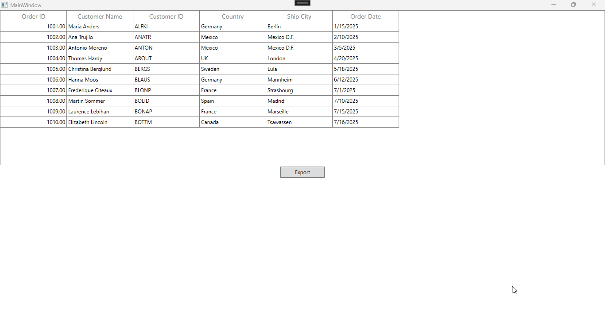

# How to remove empty worksheets during excel export in WPF DataGrid?

In [WPF DataGrid](https://www.syncfusion.com/wpf-controls/datagrid) (SfDataGrid), during Excel export, the workbook is created with three worksheets by default. To remove the empty worksheets in the workbook can be achieved by programmatically checking the empty sheets and removing them before saving the excel file.

```csharp
private void OnExcelExporting(object sender, RoutedEventArgs e)
{
    var options = new ExcelExportingOptions();
    options.ExcelVersion = ExcelVersion.Excel2016;
    options.ExportAllPages = true;          
    var excelEngine = dataGrid.ExportToExcel(dataGrid.View, options);
    var workBook = excelEngine.Excel.Workbooks[0];           
    
    // To remove the empty sheets
    for (int i = workBook.Worksheets.Count - 1; i >= 0; i--)
    {
        var worksheet = workBook.Worksheets[i];
        if (worksheet.UsedRange.LastRow == 0 || worksheet.UsedRange.LastColumn == 0)
        {
            workBook.Worksheets.Remove(i);
        }
    }

    workBook.SaveAs("Export.xlsx");
    Process.Start(new ProcessStartInfo { FileName = "Export.xlsx" });
}
```



Take a moment to peruse the [WPF DataGrid - ExportToExcel](https://help.syncfusion.com/wpf/datagrid/export-to-excel) documentation, where you can find about excel exporting with code examples.